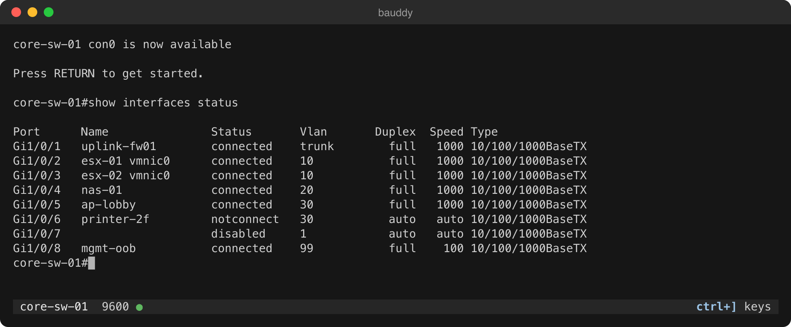

<h1 align="center"></h1>

bauddy is a serial console for servers, switches and routers. Plug in a USB
console cable, run `bauddy`, and you're on the console. It works out the
port and baud rate for you, and the keys you need are always on screen.

It's also an MCP server, so an AI agent such as Claude can use the console
while you watch. It asks you first before commands that commonly reboot,
erase or save the device.

Free and open source (MIT). Early beta for macOS, Linux and Windows: not yet
tested on real hardware or on Windows, so expect rough edges and please
[report them](https://github.com/ssimpson89/bauddy/issues).



## What it does

- **Finds the port.** With one cable it connects straight away. With none
  plugged in yet, it waits for one. With several, it lists them; not sure
  which is yours? Unplug it and plug it back in, and bauddy points to it.
- **Finds the baud rate.** It listens to the device and picks the rate that
  makes sense, then remembers it for that cable. It won't send anything to
  the device without asking first. If a remembered rate gets no reply, it
  says so and offers to detect again; until the device answers, only Enter
  goes out, since keys at the wrong rate can reach a Linux console as a
  BREAK.
- **Shows the keys.** There's one key to remember, `ctrl+]`, and it's always
  on the bottom line. Press it to see the rest.
- **Tells you when something's wrong.** If the output turns to garbage, the
  bottom line suggests detecting the rate again. If the cable comes out, it
  turns red and reconnects when you plug it back in.
- **Keeps a log if you ask.** Press `ctrl+]` then `l`. The log includes what
  was already on screen, so you can turn it on after the fact.
- **Pastes carefully.** Pasting a config sends it a line at a time and waits
  for the device to catch up. It stops at the first error and asks before
  pasting commands that commonly reboot or wipe the device.
- **Lets an AI agent help (MCP).** `bauddy mcp` gives Claude, or any other
  Model Context Protocol client, the console: "the switch on my console
  cable isn't passing traffic, take a look". See
  [Use it with an AI agent](#use-it-with-an-ai-agent-mcp-server).

## Install

With [Homebrew](https://brew.sh) on a Mac or Linux:

```
brew install ssimpson89/tap/bauddy
```

`brew upgrade` keeps it up to date. For betas too, install
`ssimpson89/tap/bauddy@beta` instead (`brew uninstall bauddy` first; only
one can be installed). Until the first stable release, both get the betas.

Or download the file for your system from the
[releases page](https://github.com/ssimpson89/bauddy/releases), unzip it,
and put `bauddy` somewhere on your path:

- Mac with Apple silicon: `darwin_arm64`; Intel Mac: `darwin_amd64`
- Most Linux PCs: `linux_amd64`; Raspberry Pi: `linux_arm64` or `linux_armv7`
- Windows: `windows_amd64` (a zip with `bauddy.exe`)

**macOS** blocks a downloaded file the first time, because it isn't signed
by Apple (Homebrew takes care of this for you). Allow it in System Settings
→ Privacy & Security, or run `xattr -d com.apple.quarantine bauddy`.

Check it works with `bauddy --version`. To check the download, run
`shasum -a 256 -c checksums.txt --ignore-missing` (`sha256sum` on Linux)
with `checksums.txt` from the same release.

Or, with Go 1.26 or later (on a Mac, also Xcode's command line tools):

```
go install github.com/ssimpson89/bauddy/cmd/bauddy@latest
```

## Use

```
bauddy                  # connect to your USB console cable
bauddy ttyUSB0          # a specific port
bauddy -b 9600          # a specific baud rate
bauddy list             # show the ports bauddy can see
bauddy keys             # show every key
```

Everything you type goes to the device, so Ctrl-C, Esc and the arrow keys work
as usual. When you want bauddy itself, press `ctrl+]` and the bottom line
shows what's next:

![the keys, after pressing ctrl+\]](docs/keys.png)

| Key | What it does |
|---|---|
| `?` | show every key |
| `b` | pick a baud rate |
| `d` | detect the baud rate |
| `r` | reconnect to the port |
| `l` | start or stop a log |
| `h` | scroll back through earlier output (the last 10,000 lines) |
| `/` | search earlier output |
| `c` | clear the screen |
| `B` | send BREAK (Cisco ROMMON, Linux SysRq) |
| `S` | tell a remote shell the window size |
| `q` | quit |
| `esc` | back to the console |

Lowercase keys act on bauddy. Capitals send something to the device.

## Good to know

- **Linux** may say you don't have permission to open the port. bauddy tells
  you which group to join (usually `dialout`); then log out and back in.
- **If `ctrl+]` is awkward on your keyboard**, use another key:
  `bauddy --escape ctrl+t`, or set `BAUDDY_ESCAPE=ctrl+t` in your shell.
- **Older equipment** that uses 7-bit framing (7E1) is detected too. You can
  also set it yourself with `-f 7E1`.
- **Logs** go in the current folder unless you say otherwise:
  `bauddy --log=~/console-logs` logs from the start into that folder.
  A log records what the device sends, including the commands it echoes
  back, so a password typed in a command (`enable secret …`) ends up in it.
- **Open bauddy twice** on the same port and both windows share the console:
  everything the device prints shows in both, and either can type. (Not on
  Windows yet.)
- **Arduino and ESP32 boards** may reset when bauddy connects. That's the
  board, not bauddy.

---

## Use it with an AI agent (MCP server)

`bauddy mcp` is a Model Context Protocol (MCP) server for serial consoles. It
lets an AI agent such as Claude use the console: find the port, detect the
baud rate, run commands and read the output. Then ask something like "my
switch on the console cable isn't passing traffic, take a look". Commands go
through the same careful paste, so they arrive intact and stop at the first
error or question.

### Add it

```
claude mcp add bauddy -- bauddy mcp                   # this project only, just you (the default: --scope local)
claude mcp add --scope user bauddy -- bauddy mcp      # every project, just you
claude mcp add --scope project bauddy -- bauddy mcp   # this project, shared with everyone in .mcp.json
claude --mcp-config '{"mcpServers":{"bauddy":{"command":"bauddy","args":["mcp"]}}}'   # this session only
claude mcp remove bauddy                              # remove it, from whichever scope it is in
```

Add `--read-only` after `bauddy mcp` and the agent can connect and read the
console, but has no way to type anything.

For Claude Desktop, add this to `claude_desktop_config.json`, with the full
path to `bauddy`:

```json
{ "mcpServers": { "bauddy": { "command": "/usr/local/bin/bauddy", "args": ["mcp"] } } }
```

### Watch it work

If you already have the console open in bauddy, the agent joins your window
instead of taking the port, and you see every command as it types it. If
bauddy isn't open, the agent opens the port itself; open bauddy later and it
joins.

- While it's working, the bottom line turns violet:
  `Claude Code is working   esc stop it   ctrl+c stop + interrupt device`.
  Your other keys, except `ctrl+]`, are ignored until it's done, so they
  can't land in the middle of its command.
- **esc** stops it. A command it typed but hadn't entered is erased; one it
  had entered keeps running on the device.
  **ctrl+c** stops it and also sends ctrl+c to the device, as if you had
  typed it, which interrupts whatever is running there.
- Either way it's then paused: it can still read, but can't type until you
  press `ctrl+]` then `p`, as the bottom line says
  (`Claude Code paused · ctrl+] p resumes`). The pause stays if it
  disconnects, so one that reconnects can't type either. Between its
  commands, `ctrl+]` then `p` pauses it.
- Claude Code may also ask you before each command, depending on its
  settings. Don't rely on that.
- Not on Windows yet.

### Approvals

bauddy asks you, not the agent, before it sends:

- a reboot, erase or upgrade
- a command that saves or commits the configuration
- `debug`, or clearing BGP sessions or console lines
- BREAK
- an answer to the device's own `[confirm]` question
- anything at a bootloader prompt

If your MCP client can't ask you, bauddy refuses, unless you started it with
`bauddy mcp --allow-risky`.

This is a safety net, not a guarantee. It doesn't ask about configuration
changes such as shutting an interface or changing a route, which can cut you
off too, and aliases or scripts can get past it. Read what the agent wants
to run before you allow it.

### What the agent sees

- What the console prints from when it joined, not before, so log in first
  if you'd rather it didn't see that.
- Everything after that, including any passwords in the configuration.
- Logs go in `~/.local/state/bauddy/logs` (`%LocalAppData%\bauddy\logs` on
  Windows), readable only by you. Use `--log DIR` to choose another folder,
  or `--no-log` to turn logging off.

## License

MIT. See [LICENSE](LICENSE). Changes are listed on the
[releases page](https://github.com/ssimpson89/bauddy/releases); to build or
contribute, see [CONTRIBUTING.md](CONTRIBUTING.md). Found a security problem?
See [SECURITY.md](SECURITY.md).
